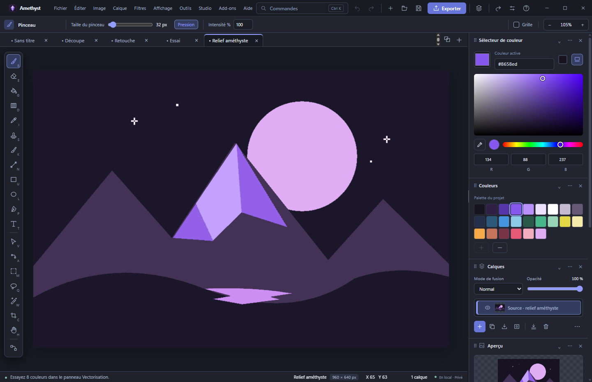

<p align="center">
  
</p>

<h1 align="center">Amethyst</h1>

<p align="center">
  
  
  
  
  
</p>

<p align="center">
  <strong>Paint pixels, draw vectors and trace images in one document.</strong><br>
  Pixel layers · Bézier paths · typography · image tracing · offline-first
</p>

<p align="center">
  <a href="https://github.com/itsnelys/Amethyst-Releases/releases/latest"><b>Download the latest version</b></a> ·
  <a href="https://github.com/itsnelys/Amethyst-Releases/releases">All releases</a>
</p>

---

Amethyst is the image editor and vector illustration app of the Pandora Interactive suite. Paint and retouch raster images, draw editable Bézier shapes, lay out text and turn pictures into vector paths—all in the same project. No account or browser is required; projects and preferences stay on your computer.

This repository hosts the **official Windows builds and release notes**. The application source code is private.

<p align="center">
  
</p>

## Download

| File | What it is |
| --- | --- |
| [**Amethyst-Setup.exe**](https://github.com/itsnelys/Amethyst-Releases/releases/latest/download/Amethyst-Setup.exe) | Installer with Start menu shortcuts and `.amethyst` file association. Recommended. |
| [**Amethyst-Portable.exe**](https://github.com/itsnelys/Amethyst-Releases/releases/latest/download/Amethyst-Portable.exe) | Runs without installation, from any folder or USB drive. |
| `Amethyst.notpatch` · `Amethyst.updater` | Release notes and update descriptor used by Amethyst's built-in update manager. |
| `SHA256SUMS.txt` | Checksums to verify every downloadable file. |

**Requirements:** Windows 10 or 11, 64-bit. Nothing else to install.

## Highlights

- Pixel, vector and text layers in the same document, with groups, masks, blend modes and non-destructive filters.
- Brush engine with twelve presets, custom brushes and graphics-tablet pressure.
- Pen, vector brush, line, rectangle and ellipse tools with editable points and Bézier handles.
- Image tracing in colour or silhouette mode, with smooth curves, shared borders and editable output.
- Editable typography with system fonts and detailed character and paragraph controls.
- PSD import with layers, masks, blend modes, editable text, common effects and top-level groups.
- PNG, JPEG, WebP and SVG export; Pixora `.pixel`, SVG, PSD and common image imports.
- Six themes, six languages, customizable shortcuts, crash recovery and isolated add-ons.

## Verify your download

Open PowerShell in your download folder and compare the result with `SHA256SUMS.txt`:

```powershell
Get-FileHash .\Amethyst-Setup.exe -Algorithm SHA256
```

Amethyst is not signed with a commercial certificate yet, so Windows SmartScreen may show a warning the first time. Choose **More info → Run anyway** after checking the hash.

## Support

Questions or a problem? Send a problem report from inside Amethyst, or write to **contact@pandora-interactive.fr**.

---

<p align="center"><sub><b>Amethyst</b> by Pandora Interactive · © 2026 Pandora Interactive. All rights reserved.<br>Free downloads do not grant an open-source licence. The application source code is private.</sub></p>
